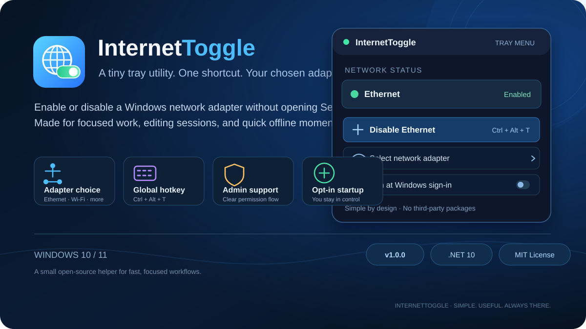

# InternetToggle

**A lightweight Windows system-tray utility for quickly enabling or disabling a selected network adapter.**

Windows 10/11 · .NET 10 · MIT License · Version 1.0.0

InternetToggle was made for workflows where you need to cut a particular connection temporarily without opening Windows Settings each time.

## Features

- Toggle the selected network adapter from the system tray.
- Use the global shortcut **Ctrl + Alt + T**.
- Select among network adapters detected by Windows.
- See the selected adapter's administrative state in the tray menu and icon.
- Optionally start at Windows sign-in.
- Remember the selected adapter between launches.
- No third-party NuGet packages.

## Important: what this app changes

InternetToggle enables or disables **one Windows network adapter**. It is not a firewall and does not block all internet traffic. If another adapter, VPN, tethered phone, or virtual network interface has a working route, apps may still have internet access.

The status shown by the app is the adapter's administrative state. It is not a test that websites or the internet are reachable, and the app does not selectively block Premiere Pro or any other application.

## Requirements

- Windows 10 or Windows 11.
- Administrator privileges to enable or disable adapters.
- .NET 10 SDK to build from source.

The app requests administrator access because Windows requires it to change adapter state. Automatic startup is **off by default** and can be enabled from the tray menu.

## Quick start

1. Launch InternetToggle and accept the Windows administrator prompt.
2. Find the app icon in the system tray near the clock.
3. Right-click the icon and open **Select network adapter**.
4. Select the adapter you want to control.
5. Use the toggle command or press **Ctrl + Alt + T**.
6. Enable **Run at Windows sign-in** only if you want the app to start automatically. Choose it again to remove the scheduled task.

If the shortcut does not work, another application may already have registered Ctrl + Alt + T.

For more detail, see the [usage guide](docs/USAGE.md).

## Build from source

From the repository root:

\`\`\`powershell
dotnet restore InternetToggle.slnx
dotnet build InternetToggle.slnx --configuration Release
\`\`\`

To publish a self-contained, single-file build for 64-bit Windows:

\`\`\`powershell
dotnet publish InternetToggle/InternetToggle.csproj --configuration Release --runtime win-x64 --self-contained true -p:PublishSingleFile=true -p:IncludeNativeLibrariesForSelfExtract=true --output artifacts/win-x64
\`\`\`

Run \`InternetToggle.exe\` from the publish folder. Build outputs are ignored by Git and should not be committed to the repository.

## Releases

The project is versioned using Semantic Versioning. The current release target is **v1.0.0**. GitHub Actions is configured to build the self-contained \`win-x64\` executable and attach it to a GitHub Release when a version tag (\`v*\`) is pushed.

Once the build workflow has completed successfully, a release can be published with:

\`\`\`powershell
git tag v1.0.0
git push origin v1.0.0
\`\`\`

See [CHANGELOG.md](CHANGELOG.md) for changes and the [v1.0.0 draft release notes](docs/releases/v1.0.0.md).

## Contributing

Bug reports and pull requests are welcome. Read [CONTRIBUTING.md](CONTRIBUTING.md) before contributing.

## License

Released under the [MIT License](LICENSE).
